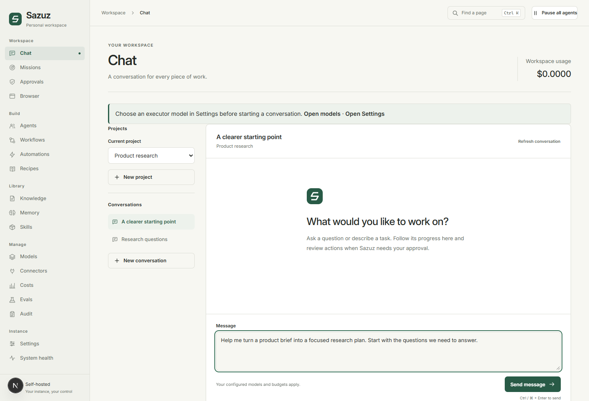
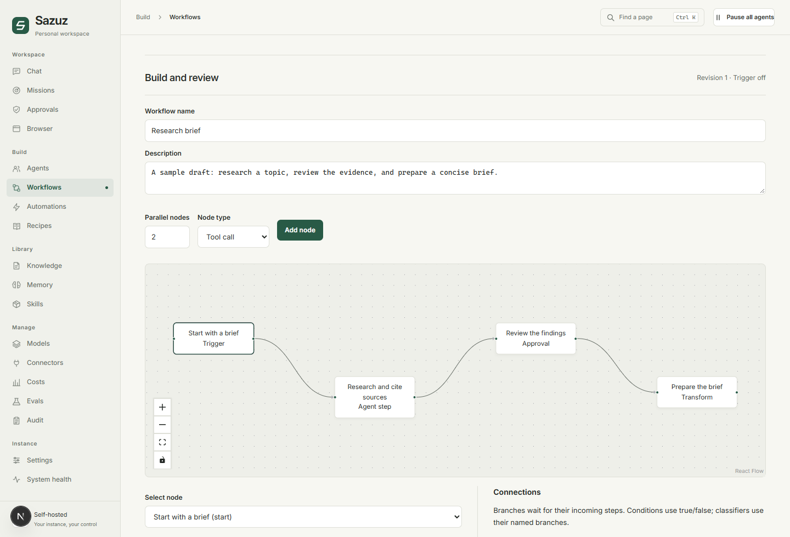
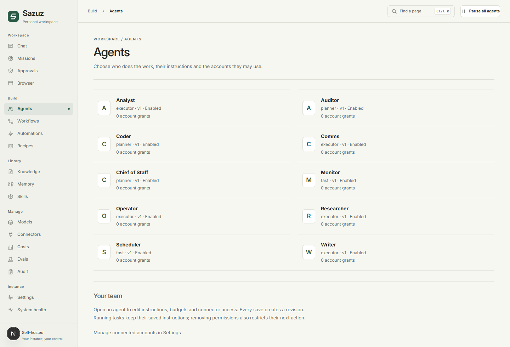
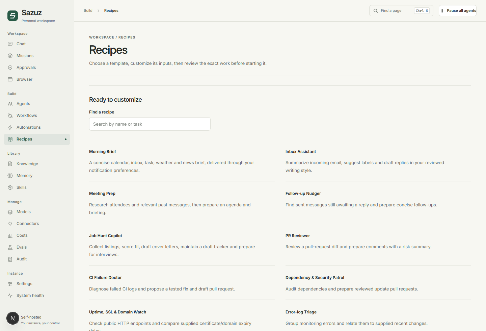
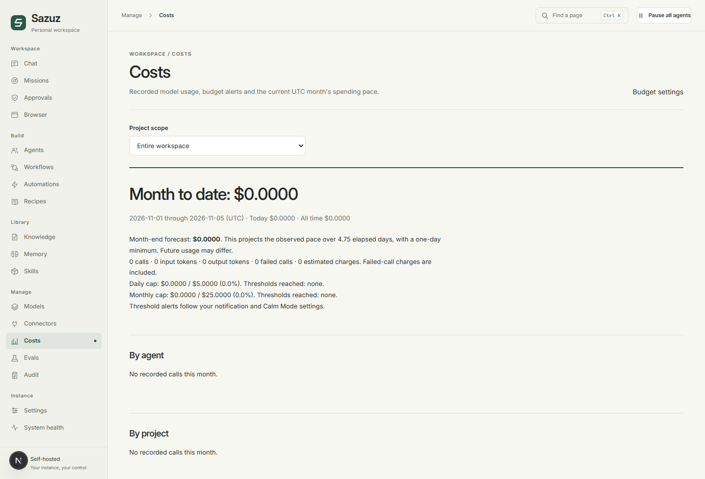
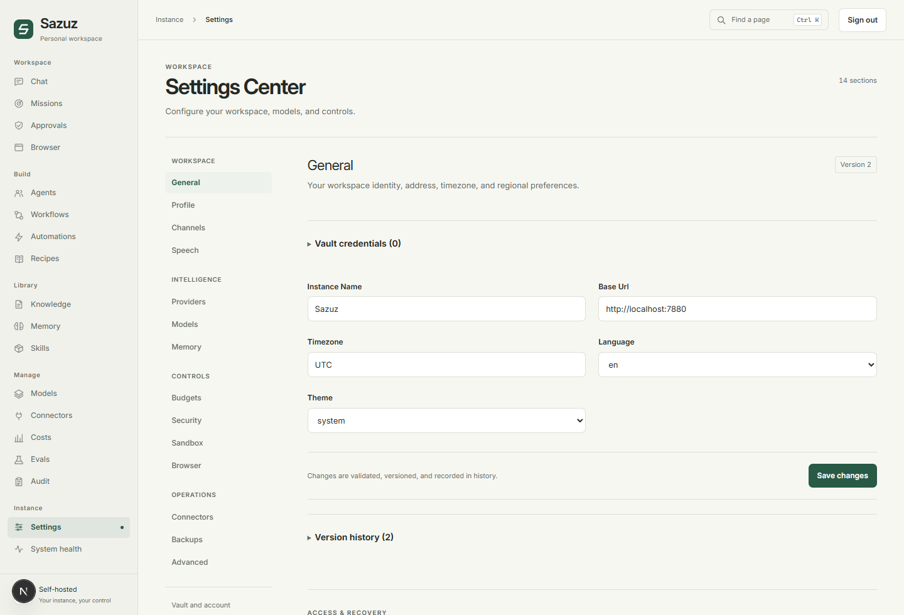
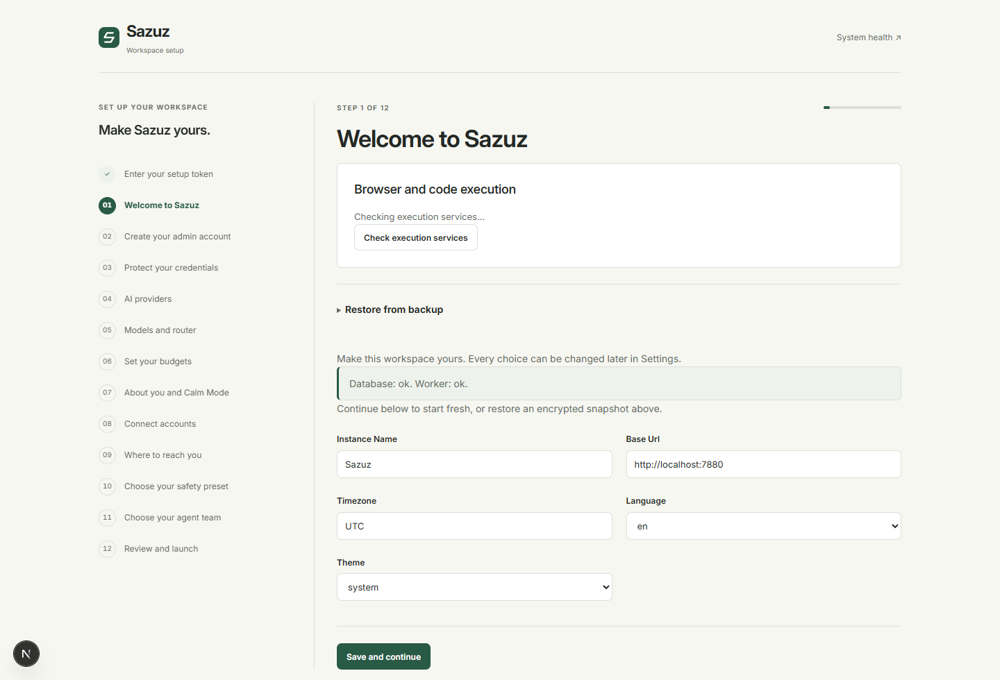
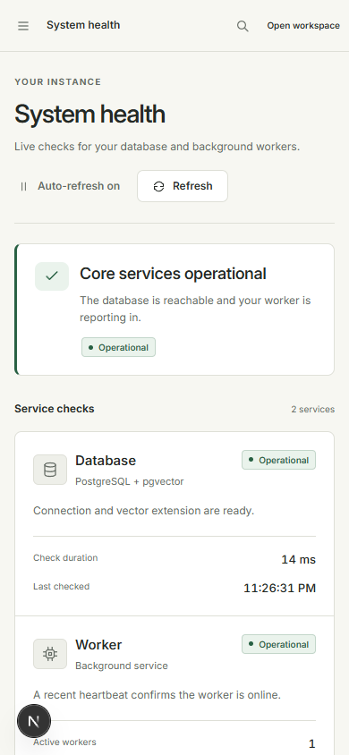
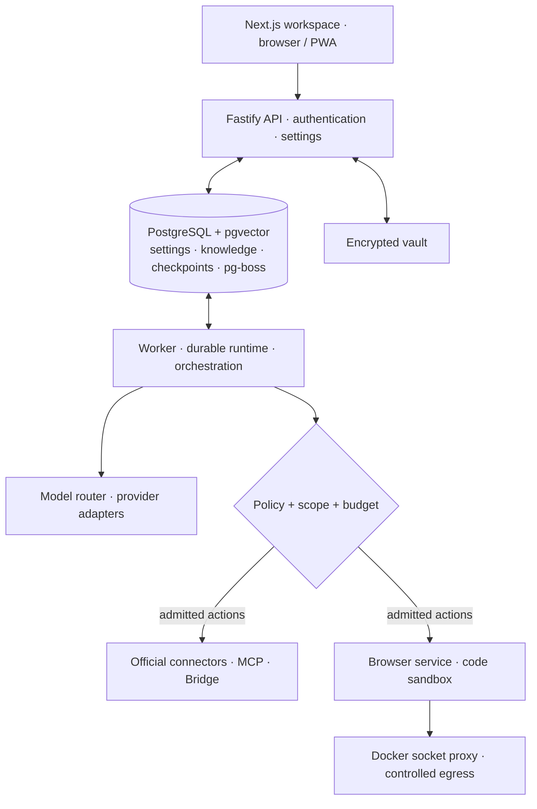
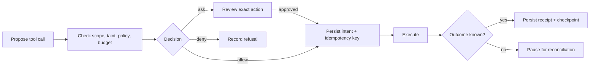

<div align="center">

<br>


# Sazuz

### Your models. Your machine. Your rules.

A self-hosted assistant platform for durable, multi-agent work.<br>
Plan in chat. Follow every step. Decide what gets done.

<p>
  <a href="LICENSE"></a>
  <a href=".node-version"></a>
  <a href="package.json"></a>
  <a href="deploy/compose.yaml"></a>
</p>

<p>
  <a href="#overview">Overview</a> &nbsp;·&nbsp;
  <a href="#interface">Interface</a> &nbsp;·&nbsp;
  <a href="#getting-started">Get started</a> &nbsp;·&nbsp;
  <a href="#architecture">Architecture</a> &nbsp;·&nbsp;
  <a href="#development">Develop</a> &nbsp;·&nbsp;
  <a href="#license">License</a>
</p>

<br>

<picture>
  <source media="(prefers-color-scheme: dark)" srcset="docs/screenshots/workspace-dark.png">
  <source media="(prefers-color-scheme: light)" srcset="docs/screenshots/workspace-light.png">
  
</picture>

<sub>The Sazuz workspace · captured from the running application with local sample content.</sub>

</div>

<br>

## Overview

Sazuz brings conversations, specialist agents, visual workflows, and connected tools into one workspace you host. Choose cloud or local models, give each agent scoped permissions, and follow work through missions, approvals, and recorded execution steps.

Configuration belongs in the product: the setup wizard creates your account and encrypted vault, then Settings manages providers, budgets, policies, and connections. **A fresh installation needs no user-edited `.env`.**

<table>
<tr>
<td width="50%" valign="top">
<h3>01 &nbsp; Choose your intelligence</h3>
<p>OpenAI, Anthropic, Google, Ollama, and compatible endpoints. Route planning, execution, fast tasks, vision, and embeddings to different models.</p>
</td>
<td width="50%" valign="top">
<h3>02 &nbsp; Set the boundaries</h3>
<p>Per-agent tools and account scopes. Allow, ask, or deny decisions. Step, cost, and time limits, with a workspace-wide pause control.</p>
</td>
</tr>
<tr>
<td valign="top">
<h3>03 &nbsp; Keep work moving</h3>
<p>Durable missions, specialist handoffs, parallel task graphs, and review. Checkpoints preserve progress; ambiguous external outcomes wait for reconciliation.</p>
</td>
<td valign="top">
<h3>04 &nbsp; See the evidence</h3>
<p>Inspect steps, citations, tool receipts, costs, and audit history. Replay and fork runs in simulation to compare a different approach.</p>
</td>
</tr>
</table>

**Current scope:** a single-owner platform with the implementation through Phase 11. Package manifests currently use `0.0.0`; v1.0 remains the release target. A published, fully verified release is not claimed here. See [roadmap and verification limits](#roadmap).

## Interface

The screenshots below come from a fresh local instance running the current UI. Sample projects and a saved workflow draft were created through the application and its API. No model responses, completed missions, or connected accounts were fabricated. Open any image for the full-size view.

### From a task to a repeatable workflow

<a href="docs/screenshots/workflow.png"></a>

<p align="center"><sub>A saved workflow draft · connect deterministic steps, agent work, and explicit review.</sub></p>

<table>
<tr>
<td width="50%" valign="top">
<a href="docs/screenshots/agents.png"></a>
<h4>Your specialist team</h4>
<p>Inspect agent responsibilities, instructions, model roles, and permissions.</p>
</td>
<td width="50%" valign="top">
<a href="docs/screenshots/recipes.png"></a>
<h4>A starting point for repeatable work</h4>
<p>Explore recipes, configure their inputs, and review permissions before installation.</p>
</td>
</tr>
<tr>
<td valign="top">
<a href="docs/screenshots/costs.png"></a>
<h4>Account for model usage</h4>
<p>Project filters, cost breakdowns, and forecasts. This fresh instance has no paid usage.</p>
</td>
<td valign="top">
<a href="docs/screenshots/settings.png"></a>
<h4>Configuration with a history</h4>
<p>Validated settings, version history, and changes applied to running services.</p>
</td>
</tr>
</table>

<details>
<summary><strong>See onboarding and the mobile interface</strong></summary>

<br>

<table>
<tr>
<td width="72%" valign="top">
<a href="docs/screenshots/setup.png"></a>
<p><strong>Guided from the first launch.</strong> Create an owner, protect the vault, and choose your configuration.</p>
</td>
<td width="28%" valign="top">
<a href="docs/screenshots/mobile.png"></a>
<p><strong>On smaller screens.</strong> Responsive navigation and live core health.</p>
</td>
</tr>
</table>

[Screenshot provenance and capture notes](docs/screenshots/README.md)

</details>

---

## Capabilities

| Area                     | What you can do                                                                                                                          | Where to start                 |
| :----------------------- | :--------------------------------------------------------------------------------------------------------------------------------------- | :----------------------------- |
| **Chat and projects**    | Organize conversations by project, set privacy and budgets, and inspect saved messages and usage.                                        | `/chat`                        |
| **Missions and agents**  | Delegate work, follow task graphs and handoffs, review evidence, and edit versioned agent definitions.                                   | `/missions` · `/agents`        |
| **Approvals**            | Inspect proposed actions, edit eligible arguments, approve or deny, and reconcile uncertain outcomes.                                    | `/approvals`                   |
| **Workflows**            | Combine tools, agents, skills, conditions, transforms, waits, bounded maps, and review nodes. Save and review a revision before running. | `/workflows`                   |
| **Automations**          | Configure schedules, RSS, IMAP, and signed webhooks; manage Telegram pairing and Calm Mode digests.                                      | `/automations`                 |
| **Knowledge and memory** | Ingest documents or URLs, search indexed content with citations, and review or forget scoped memories.                                   | `/knowledge` · `/memory`       |
| **Skills and recipes**   | Edit reusable instructions, configure recipe templates, review proposed skills, and manage writing-style profiles.                       | `/skills` · `/recipes`         |
| **Browser and code**     | Use scoped browser sessions with live human takeover; execute Python or Node in hardened Docker sandboxes.                               | `/browser`                     |
| **Teach by watching**    | Record browser actions, review a parameterized skill, dry-run it, and inspect proposed replay repairs.                                   | `/browser` · `/skills`         |
| **Connections**          | Configure official accounts, review MCP tool manifests, and pair a folder-scoped local Bridge.                                           | `/connectors`                  |
| **Observability**        | Inspect costs, run evaluations, simulate forks, export telemetry, and download hash-chained audit evidence.                              | `/costs` · `/evals` · `/audit` |
| **Operations**           | Manage passkeys, TOTP, encrypted backups, vault recovery, updates, reviewed voice input, and consented push notifications.               | `/settings`                    |

### Connect the services you already use

| Category                 | Implemented integrations                                                              |
| :----------------------- | :------------------------------------------------------------------------------------ |
| Mail and calendars       | Gmail, Google Calendar, IMAP/SMTP, Microsoft Outlook and Calendar, CalDAV, CardDAV    |
| Documents and files      | Google Drive, Sheets, Docs, OneDrive, Notion                                          |
| Communication            | Slack and Discord bot APIs; Telegram channel delivery and pairing                     |
| Development and planning | GitHub, Linear, Jira, Todoist                                                         |
| Other                    | Read-only Stripe balance/invoices, outbound webhooks, signed inbound webhooks         |
| Extensibility            | MCP client and server; outbound local Bridge for permitted folders and fixed commands |

Each connector exposes a bounded set of operations, not its provider's entire API. Configure the account, resource, and permissions, then grant access to the intended agent. Browser logins, 2FA, and CAPTCHAs use human takeover. [Connection and security notes →](docs/reference.md#connections)

## Architecture



The web application is the owner-facing workspace and same-origin API proxy. Fastify handles authentication and application APIs. Workers consume PostgreSQL-backed jobs and checkpoint execution. Shared packages contain the domain contracts, model adapters, policy engine, and runtime.

<details>
<summary><strong>How an action moves from intent to evidence</strong></summary>



- Tools declare an effect: `read`, `write`, `send`, `delete`, `spend`, or `publish`. An unknown effect is treated as a write and asks for approval.
- Step, cost, and wall-time budgets constrain runs; loop detection is always active.
- External content is wrapped as untrusted and taints the run. Consequential actions receive additional review.
- Secrets use `secret://<id>` references. Argon2id and XChaCha20-Poly1305 protect vault envelopes; execution resolves secrets and redacts observations.
- Side effects use durable intents and receipts. An unknown remote outcome is reconciled before another attempt; idempotency is not assumed of every external service.
- Settings are zod-validated, stored in Postgres, versioned in `settings_history`, and refreshed with LISTEN/NOTIFY.

[Security boundaries and recovery details](docs/reference.md#security-and-recovery)

</details>

---

## Getting started

### Prerequisites

| Installation             | Requirements                                                                                                                                                        |
| :----------------------- | :------------------------------------------------------------------------------------------------------------------------------------------------------------------ |
| **Docker — recommended** | Docker Engine/Desktop **26+**, Linux containers, and Docker Compose **2.24.4+**. Git is needed for the clone command below.                                         |
| **Host development**     | Node.js **26.13.0**, pnpm **11.25.0**, and PostgreSQL 16 with pgvector; `pnpm dev` can provision the database through Docker.                                       |
| **Resources**            | Plan for **4 CPU cores / 8 GiB RAM** for core and browser services. This is planning guidance, not a measured minimum. Local models and voice need extra resources. |

Install Docker from its [official installation guide](https://docs.docker.com/get-docker/). Docker installations do not require Node.js or pnpm on the host.

### 1. Install from source

```sh
git clone https://github.com/iForge-Technologies/Sazuz.git
cd Sazuz
bash install.sh
```

On Windows, clone the repository, open PowerShell in its directory, and run:

```powershell
powershell.exe -NoProfile -ExecutionPolicy Bypass -File .\install.ps1
```

The installer checks Docker, builds the source checkout, selects a free loopback port starting at **7777**, waits for health, and opens `/setup`. It prints a private setup token and installs the `sazuz` CLI wrapper. Paste the token into the wizard; it is not placed in the URL.

### 2. Make it yours

1. **Create the owner account.** Set your login details.
2. **Create the vault.** Download the recovery kit, store it privately, and confirm its last four characters.
3. **Choose providers and models.** Enter credentials in the vault; select cloud or local endpoints and model roles.
4. **Set limits and permissions.** Review budgets, policies, channels, and agent configuration.
5. **Review and launch.** Open Models to discover/test models and record their prices.

You can skip optional setup sections and configure them later. Model-backed tasks need a working model route. Closing the wizard preserves progress; finishing it removes the token and disables `/setup`.

### 3. Start with one useful task

Create a project in **Chat**, give it a brief and budget, and start a conversation. For a first knowledge task, upload a short document in **Knowledge**, then ask:

> Summarize the uploaded brief in five bullets. Cite the source for each key claim and list the questions that still need an answer.

Use **Missions** for delegated work and its execution evidence. Use **Approvals** to review proposed actions. Once a process is useful, build a reviewed workflow or configure a recipe and schedule it in **Automations**.

<details>
<summary><strong>Optional services, health, and restarting</strong></summary>

For an installer-created source deployment, enable the browser profile with the same saved port override:

```sh
docker compose -p sazuz -f deploy/compose.yaml -f data/compose.install.yaml --profile browser up --build --detach --wait
```

Use `--profile voice` for the local Whisper/Piper services. Configure speech models and endpoints in Settings afterward. These profiles and the code sandboxes require Docker; the host-only UI does not provide container isolation.

Check the instance:

```sh
sazuz doctor
```

Restart an installer-created source deployment that has not activated a release:

```sh
docker compose -p sazuz -f deploy/compose.yaml -f data/compose.install.yaml stop
docker compose -p sazuz -f deploy/compose.yaml -f data/compose.install.yaml up --detach --wait
```

Retain any enabled `--profile` options when bringing optional services back up. For prepared releases or updated instances, preserve the additional release override files and their order; [see deployment details](docs/reference.md#deployment-and-data).

The default local workspace is [http://127.0.0.1:7777](http://127.0.0.1:7777); use the port printed by the installer. `/health` shows service health, and `/api/health` exposes its JSON result.

</details>

## Configuration

**Use `/setup` initially and `/settings` afterward.** API keys, models, budgets, connector accounts, channels, safety preferences, and agent choices are application settings. Secrets are entered through vault controls and referenced by ID.

| Setting                   | Purpose                                                                              |
| :------------------------ | :----------------------------------------------------------------------------------- |
| Providers and models      | Endpoints, vault references, role routing, model discovery/testing, and token prices |
| Budgets and safety        | Run limits, concurrency, policy presets, and scoped rules                            |
| General and Calm Mode     | Instance name, origin, timezone, appearance, quiet hours, and interruption limits    |
| Accounts and connections  | Resource-specific accounts, OAuth, channels, MCP, and Bridge grants                  |
| Vault and recovery        | Lock/unlock, Auto or Strict mode, passphrase changes, and recovery-kit replacement   |
| Backups and notifications | Encrypted snapshots, schedules, speech preferences, and device consent               |

### Environment variables

**None are required for a fresh install.** Advanced `SAZUZ_*` overrides configure infrastructure only: data location, database connection, service ports/URLs, and execution plumbing. Unknown `SAZUZ_*` keys cause startup to fail. Do not put provider keys in an environment file.

[Complete infrastructure variable reference →](docs/reference.md#infrastructure-variables)

## Tech stack

| Layer                         | Technologies verified in the repository                                                           |
| :---------------------------- | :------------------------------------------------------------------------------------------------ |
| Workspace                     | Next.js **16.4.4**, React **19.3.1**, Tailwind CSS **4.3.4**, TanStack Query, Zustand, React Flow |
| API and execution             | Node.js **26.13.0**, TypeScript **5.9.3**, Fastify **5**, pg-boss, Vercel AI SDK adapters         |
| Persistence and validation    | PostgreSQL **16**, pgvector **0.8.6**, Drizzle ORM, zod **4**                                     |
| Identity and secrets          | Better Auth, SimpleWebAuthn, TOTP, libsodium, Argon2id, XChaCha20-Poly1305                        |
| Tool infrastructure           | Playwright, Docker, validating socket proxy, controlled egress, MCP SDK                           |
| Quality and workspace tooling | pnpm **11.25.0**, Turborepo, Vitest, Playwright Test, ESLint, Prettier                            |

Dependency pins live in [package.json](package.json), [workspace manifests](pnpm-workspace.yaml), and [pnpm-lock.yaml](pnpm-lock.yaml). Container definitions live in [deploy/compose.yaml](deploy/compose.yaml).

## Project structure

```text
Sazuz/
├── apps/
│   ├── web/              Next.js workspace and API proxy
│   ├── server/           Fastify application API
│   ├── worker/           Durable job processing
│   ├── browser/          Browser execution service
│   ├── bridge/           Local companion CLI
│   └── cli/              Operator commands
├── packages/             Shared contracts and domain services
│   ├── config/ · db/ · vault/ · policy/
│   ├── llm/ · runtime/ · orchestrator/ · tools/
│   ├── workflows/ · memory/ · skills/ · evals/
│   └── connectors/ · channels/ · triggers/ · mcp/ · bridge/ …
├── agents/               Built-in agent definitions
├── recipes/              Configurable workflow recipes
├── skills/               Built-in instruction bundles
├── deploy/               Container images, Compose, and release definitions
├── scripts/              Development, migration, release, and verification tools
├── tests/                Integration, browser, frontend, and deployment checks
└── docs/                 Public reference and genuine screenshots
```

## API

Sazuz exposes a Fastify API with a generated OpenAPI document at **`/api/openapi.json` on the direct API server**. The web app proxies approved workspace endpoints; it does not expose the OpenAPI document. Workspace endpoints use owner sessions.

```sh
curl --fail http://127.0.0.1:7777/api/health
# Direct API in host development:
curl --fail http://127.0.0.1:7778/api/openapi.json
```

Use your actual installation ports. Production keeps the direct API internal. For external agent clients, **`/mcp`** provides explicitly granted, project-scoped tools using Streamable HTTP and a vault-backed bearer credential.

[Endpoint map, authentication, and extension points →](docs/reference.md#api-reference)

---

## Development

With the pinned Node.js and pnpm versions installed:

```sh
pnpm install --frozen-lockfile
pnpm dev
```

`pnpm dev` generates private infrastructure credentials, connects to PostgreSQL or starts the development database through Docker, applies migrations, and starts web, server, and worker. Retrieve the wizard token in another terminal:

```sh
pnpm sazuz setup-token
```

The default web port is `7777`, API port `7778`, and development database port `54329`. Keep the generated `data/` directory private and preserve it with the database.

### Check a change

```sh
pnpm lint
pnpm typecheck
pnpm test
```

| Command                 | Purpose                                                                             |
| :---------------------- | :---------------------------------------------------------------------------------- |
| `pnpm build`            | Build the production application and utilities                                      |
| `pnpm test:integration` | Exercise real PostgreSQL integration paths; Docker is the default database provider |
| `pnpm test:coverage`    | Run combined unit/integration coverage and enforce thresholds                       |
| `pnpm test:e2e`         | Exercise an already running disposable application stack                            |
| `pnpm test:frontend`    | Check workspace layout, keyboard access, and interface contracts                    |
| `pnpm test:dev`         | Start and verify the development stack, including worker recovery                   |
| `pnpm db:migrate`       | Apply database migrations                                                           |

Install the browser with `pnpm exec playwright install chromium`; on Linux, use `--with-deps` when system libraries are needed. Full browser suites create test accounts and mutate data: use a disposable instance. [Test setup and optional controls](docs/reference.md#test-environments)

Keep packages independent of `apps/*`, validate boundaries with zod, preserve policy/vault/durability contracts, and run the three checks above before each Conventional Commit. Contributions and distributed modifications must respect the [GNU GPL v3.0 license](LICENSE) and applicable third-party licenses.

## Troubleshooting

| Symptom                                      | What to check                                                                                                                          |
| :------------------------------------------- | :------------------------------------------------------------------------------------------------------------------------------------- |
| Installer cannot start                       | Check `docker version` and `docker compose version`. Enable Linux containers and start the Docker daemon.                              |
| The expected port is unavailable             | Use the address printed by the installer; it searches from port 7777.                                                                  |
| `/setup` returns 404                         | Setup has already completed. Use `/login`; use the operator CLI for account recovery.                                                  |
| A model request fails                        | Confirm its endpoint, model ID, vault reference, and routing in Settings, then test it in Models. Check that the vault is unlocked.    |
| Work waits for approval                      | Open Approvals and inspect the proposed action, permissions, and current run state.                                                    |
| Work stops or remains paused                 | Inspect budget limits, global pause, worker health, and any unresolved external outcome in the mission.                                |
| Browser or sandbox is unavailable            | Start the required Docker services/profile and inspect execution diagnostics under System health.                                      |
| A passkey cannot be enrolled                 | Use `localhost` or your final HTTPS hostname; literal IP addresses are not supported as passkey RP IDs.                                |
| Database connection fails during development | Check Docker or the configured PostgreSQL/pgvector instance. Existing database credentials must match the retained private data files. |

For recovery, use `sazuz doctor`, `sazuz unlock`, or `sazuz reset-admin` in the installed CLI. Sensitive values are entered through private prompts. [Recovery and deployment reference](docs/reference.md#security-and-recovery)

## FAQ

<details>
<summary><strong>Can I use local models?</strong></summary>

Yes. Configure Ollama or a compatible endpoint in Settings, then assign models to roles. Discovery, structured outputs, tool use, vision, and embeddings depend on the endpoint and model. A local model server must be reachable from the Sazuz process or containers.

</details>

<details>
<summary><strong>Does Sazuz require an API subscription or an environment file?</strong></summary>

There is no required hosted Sazuz account or user-edited `.env`. Cloud providers and connected services may charge for their use. You supply their credentials through the vault. Local models still require suitable hardware.

</details>

<details>
<summary><strong>What happens after a restart?</strong></summary>

The runtime restores persisted checkpoints and receipts. Known completed effects are not repeated; uncertain effects require reconciliation. In Auto mode the host machine key unlocks the vault; in Strict mode you unlock it after a server restart. Restored backups intentionally leave execution paused for review.

</details>

<details>
<summary><strong>Can I use it with a team?</strong></summary>

The current product is single-owner. Identity groundwork exists, but invitations, multi-user roles, project membership routing, and OIDC are future work.

</details>

<details>
<summary><strong>Is this open source? Can my business use it?</strong></summary>

Yes. Sazuz is licensed under **GNU GPL v3.0**, an open-source copyleft license. Personal and commercial use, modification, and redistribution are allowed under its terms. When distributing covered software, preserve required notices, license the covered work under GPL v3.0, and provide the corresponding source as required. Read the [full license](LICENSE) for the conditions.

</details>

## Roadmap

The implementation covers the original Phase 0–11 scope. Release verification and future product work are separate:

| Status                           | Scope                                                                                                                                                                         |
| :------------------------------- | :---------------------------------------------------------------------------------------------------------------------------------------------------------------------------- |
| **Implemented**                  | Wizard, vault, policy, durable execution, multi-agent missions, connectors, workflows, browser/code tools, knowledge, skills, observability, voice/PWA, and recovery controls |
| **Release verification pending** | Native AMD64/ARM64 Docker execution, fresh-host installation and restore, actual container update rollback, and release publication                                           |
| **Live acceptance pending**      | Real provider/account checks, hardware passkeys, physical microphones, browser push delivery, and configured-model quality evaluations                                        |
| **Future scope**                 | Team invitations and roles, project membership routing, and OIDC SSO                                                                                                          |

The [release workflow](.github/workflows/release.yml) and [CI checks](.github/workflows/checks.yml) describe the release machinery. Local fixture tests and UI captures do not establish live integration quality or container isolation. Current bounds include local backups with a **128 MiB plaintext archive limit**, speech input up to **30 seconds**, and a PWA offline screen that contains no workspace data.

## Credits

Sazuz builds on the work of the [Node.js](https://nodejs.org/), [TypeScript](https://www.typescriptlang.org/), [Next.js](https://nextjs.org/), [React](https://react.dev/), [Fastify](https://fastify.dev/), [PostgreSQL](https://www.postgresql.org/), [pgvector](https://github.com/pgvector/pgvector), [Playwright](https://playwright.dev/), and [Model Context Protocol](https://modelcontextprotocol.io/) communities, alongside the dependencies listed in the workspace manifests.

The interface uses [Inter](https://rsms.me/inter/), distributed under its [SIL Open Font License](apps/web/public/fonts/OFL.txt). Third-party packages, models, and assets retain their own licenses and attribution requirements.

## License

**[GNU General Public License v3.0](LICENSE)** · Copyright © 2026 iForge Technologies LLP.

Sazuz is free software: you may use, modify, and redistribute it under **version 3 of the GNU General Public License**. Commercial use is permitted. Distribution of covered software must comply with GPL v3.0, including its notice, licensing, and corresponding-source requirements.

The software is provided **without warranty**. Third-party components retain their own licenses. See [LICENSE](LICENSE) for the complete terms.

<br>

---

<p align="center">
  <strong>Sazuz</strong><br>
  <sub>Your models. Your machine. Your rules.</sub>
</p>

<p align="center">
  Developed by <a href="https://www.iforge.in/"><strong>iForge Technolgoies LLP</strong></a>
</p>
